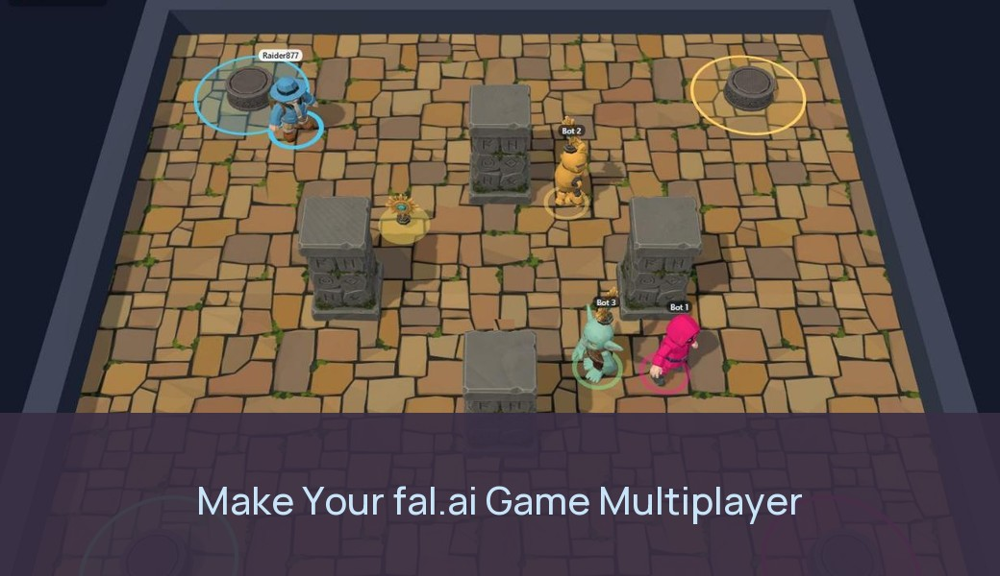
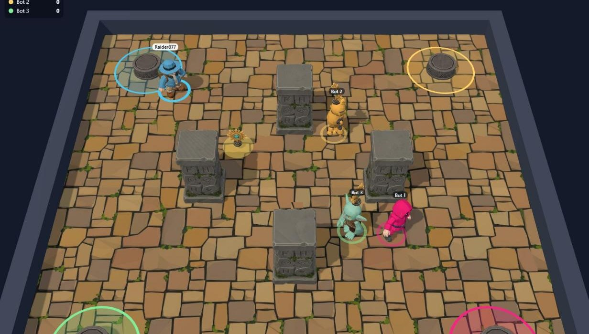
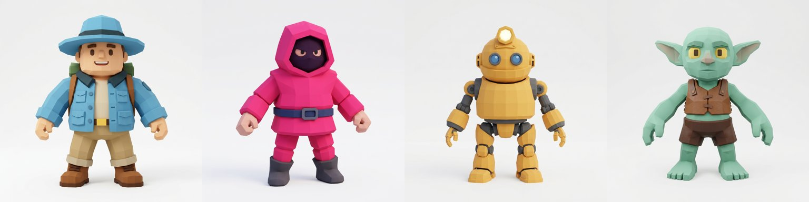

# Relic Rumble: a 3D game made with fal.ai assets, multiplayer on Edgegap



A worked example you can follow step by step. A coding agent writes a 3D browser game (Three.js),
**fal.ai** generates everything you see and hear (rigged characters, props, floor, sounds), and
**Edgegap** makes it online: a matchmaker puts 2 to 4 players together and starts one authoritative
server for their match.



In Relic Rumble four raiders grab relics in the middle of the floor and carry them to their own
corner. A shove knocks a rival back and makes them drop what they carry. First to 5 wins.

```
coding agent ──writes──> client/  rules.js (the rules)  render.js (Three.js)  main.js (page)
fal.ai ──generates──> client/assets/  4 rigged characters, relic, pillar, pedestal, floor, 5 sounds
                         │
                         │ rules.js is shared, unchanged; assets stay in the page
                         v
your page ──Find match──> Edgegap matchmaker ──starts──> one Node.js server per match
     <──────────── wss://<id>.pr.edgegap.net:<port> ────  runs rules.js at 60 Hz, fills seats
                                                           with bots, stops itself after the match
```

fal is used when you build the game, Edgegap when people play it. A match makes no call to fal,
and the server image contains no model, texture or sound.

This repo is a recipe, not a live demo: you create your own Edgegap app version and matchmaker,
play, and remove them when you're done. Each server stops itself when its match ends, so you pay
only while people play.

Verified on 2026-11-17: two headless players (`tests/e2e.mjs`) and two real browser tabs were
matched through the Edgegap matchmaker onto one server, played a full match, and the server stopped
itself 20 seconds after it. A match runs on one 0.25 vCPU server.

## What you need

- A fal account with a few dollars of credit. All the assets here cost about $6.30 at list prices
  ([PROMPTS.md](PROMPTS.md) has every prompt, model and price).
- An Edgegap account (app.edgegap.com). The free tier is enough: one matchmaker that stops about
  3 hours after each start.
- A GitHub repo. GitHub Actions builds the server image, so you don't need Docker.
- A coding agent (Claude Code, Codex, Cursor...) with two connections:
  - fal: the `genmedia` CLI (`genmedia setup`), or the fal MCP server
    (`claude mcp add --transport http --scope user fal https://mcp.fal.ai/mcp-relay`);
  - Edgegap: the MCP server at `https://mcp.edgegap.dev`. Its `edgegap-fal` skill holds this
    workflow, the server templates, the matchmaker config and the tests.

## Step 1: Build the game as a graybox, rules in their own file

Ask the agent for the game with plain shapes first, and say where the rules live. This is the one
decision that makes the multiplayer step easy:

> Build a 3D browser game with Three.js (no build step, ES modules). Put every rule in
> `client/rules.js`: no `window`, `document`, WebGL, audio or timers in that file. It exports
> `createWorld()`, `addPlayer(world, id, name, isBot)`, `removePlayer(world, id)`,
> `setInput(world, id, input)` with plain numbers and booleans, `step(world, dt)` that returns a
> list of events, and `botInput(world, id)` that reads only positions. Characters collide as
> circles and obstacles as boxes, never as meshes. `client/render.js` draws a plain view object
> and `client/main.js` runs the solo game against bots. Every model, texture and sound is optional
> and listed in `client/assets.js`: draw a simple shape when an entry is empty.

Check it: `npm run client`, open `http://localhost:8080`, **Play vs bots**. And
`grep -nE "window|document|canvas|setTimeout|setInterval|requestAnimationFrame" client/rules.js`
prints nothing.

Pick a game that fits the network: pushing, carrying, a bit of slide and slow projectiles feel
fine without client prediction. Precise platforming and instant-hit aiming don't.

## Step 2: Generate the assets with fal



Have the agent run fal for you. For each character: one concept image, then image-to-3D with
rigging, which returns the skinned model plus walk and run clips.

```bash
bash art/gen-concepts.sh      # 4 character images (fal-ai/nano-banana-2)
bash art/gen-props.sh         # relic, pillar, pedestal, floor
bash art/gen-sfx.sh           # 5 sounds (elevenlabs/sound-effects/v3)
# each concept -> meshy/v7.1/image-to-3d (PROMPTS.md), then:
python art/fetch.py raider-blue && bash art/build.sh raider-blue
```

Then list the files in `client/assets.js`. What made it work:

- **Ask for an A-pose, separated limbs and empty hands** in the concept image, or the auto-rig fails
  or bends the wrong parts.
- **Never size the game to a model.** The renderer scales each model to a height in world units and
  measures the skinned vertices to do it: a rigged GLB carries its own node scale (Meshy's armature
  is 0.01), so a plain bounding box is 100 times off.
- **Clips can come as separate files.** Meshy returns walk and run as small armature-only GLBs; the
  loader applies them to the rigged model because the bone names match.
- **Shrink before you ship.** `art/build.sh` turns each 3.5 MB model into about 1.3 MB (1024 px WebP
  texture). The whole `client/assets/` folder is 7 MB.
- **Keep the prompts** ([PROMPTS.md](PROMPTS.md)), so you can regenerate one asset in the same style.

## Step 3: Add the server and Find match

The server is four template files from the `edgegap-threejs` skill (`server/main.js`, `room.js`,
`edgegap.js`, `util.js`) plus [`server/game.js`](server/game.js), 70 lines that wrap `rules.js`:
it clamps every input, runs the bots, steps the world and sends rounded positions 20 times a
second. The page gets **Find match** ([`client/online.js`](client/online.js), the Edgegap JS SDK)
and draws server snapshots with the same renderer as solo play.

```bash
npm install
npm run test:local      # two headless players play a full match on a local server: PASS
npm run server          # then open the page and click "Local server :7777" in two tabs
```

## Step 4: Image, app version, matchmaker

1. **Image.** In GitHub: variable `EDGEGAP_REGISTRY_PROJECT` and secrets
   `EDGEGAP_REGISTRY_USERNAME`, `EDGEGAP_REGISTRY_TOKEN` (Edgegap dashboard > Container Registry).
   The **Server image** workflow tests, builds and pushes `relic-rumble:<YYYYMMDD-HHMM>`.
2. **App version.** With the Edgegap MCP: `edgegap_create_app`, then `edgegap_create_app_version`
   with the pushed tag, port 7777 protocol WS named `gameport` with TLS Upgrade on, 256 vCPU units,
   512 MB, restart policy `never`, max duration 30 minutes, and env `EMPTY_TIMEOUT_S=15`,
   `FIRST_JOIN_TIMEOUT_S=60`, `RESULTS_SECONDS=8`, `IDLE_TIMEOUT_S=75`. The same fields exist in
   the dashboard.
3. **Matchmaker.** Put the version name and your page's origin in
   [`matchmaker/rumble.json`](matchmaker/rumble.json), then dashboard > Matchmakers > Create
   Matchmaker > upload > Create and Start. Copy its API URL and Auth Token into
   `client/config.local.js` (same shape as `client/config.js`, git-ignored).

The matchmaker Auth Token is a client token, made to ship in game pages. Never put your Edgegap
API token in the page, the repo or the image.

## Step 5: Prove it, then clean up

```bash
MM_URL=https://<id>.edgegap.net MM_TOKEN=<auth token> node tests/e2e.mjs rumble 2
```

Both players must land on one deployment, see a result, and the deployment must stop itself. Then
open the page in two tabs and click **Find match** in both within 20 seconds.

When you are done: stop or delete the matchmaker (the free tier stops it after about 3 hours
anyway) and check that no deployment of yours is still running.

## Files

| Path | What it is |
|---|---|
| `client/rules.js` | The rules, shared by the page and the server |
| `client/render.js`, `client/assets.js` | Three.js view; the list of fal assets, all optional |
| `client/main.js`, `client/online.js`, `client/net.js` | Page, Find match, WebSocket |
| `client/assets/` | The fal assets the page loads |
| `server/` | Node.js match server and its Dockerfile |
| `tests/` | Local match test and matchmaker end-to-end test |
| `art/` | fal scripts, concept images |
| `matchmaker/rumble.json` | Matchmaker config template |

## Licence

Code: MIT. The models, images and sounds in `client/assets/` and `art/` were generated with fal.ai
for this sample; check fal's and each model's terms before reusing them in a product.
